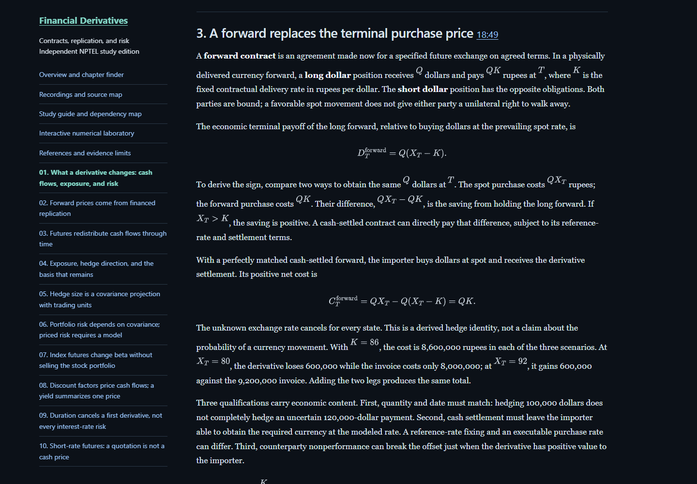

# Financial Derivatives and Risk Management

**[Read the textbook](https://az9713.github.io/nptel-financial-derivatives-risk-management-notes/)** · **[Recording map](https://az9713.github.io/nptel-financial-derivatives-risk-management-notes/source-map.html)** · **[Study guide](https://az9713.github.io/nptel-financial-derivatives-risk-management-notes/study-guide.html)** · **[Interactive laboratory](https://az9713.github.io/nptel-financial-derivatives-risk-management-notes/numerical-lab.html)**

An independent, transcript-grounded study edition of **NPTEL Financial Derivatives & Risk Management**, taught by **Prof. J. P. Singh, IIT Roorkee**. The source course supplies the topic spine; the edition develops the mathematics through explicit assumptions, worked constructions, numerical checks, executable Python laboratories, and fully reasoned exercise solutions.

[Official course](https://nptel.ac.in/courses/110107128) · [Supplied playlist](https://www.youtube.com/playlist?list=PLLy_2iUCG87CTB2vv9njHaJbmQoa9S5gK)

[](https://az9713.github.io/nptel-financial-derivatives-risk-management-notes/)

## Scope and organization

The complete edition has **24 chapters covering all 60 teaching recordings**, with the short introductory recording separately retained in the source inventory. Each chapter has **six exercises with fully worked solutions and one executable laboratory**. The source map retains both upload position and official lecture numbering: the put–call-parity upload at playlist position 61 is official lecture 31 and is studied with the surrounding option theory.

The progression covers forwards and futures, cash-and-carry, margin and basis, hedge ratios, portfolio theory and CAPM, index futures, rate curves and duration, bill and bond futures, option identities and strategies, stochastic processes and Itô calculus, binomial and Black–Scholes pricing, Greeks and finite hedges, swaps, currency risk, VaR, and nonlinear portfolio revaluation.

The reader assumes mathematical maturity without assuming prior finance knowledge. It distinguishes delivery quotation from contract value, payoff from financed profit, physical probabilities from pricing weights, and a finite numerical check from a general mathematical guarantee. A default-free pricing assumption is not a claim that real credit and funding risks disappear.

## Chapter directory

| Chapter | Topic | Playlist positions |
|---|---|---|
| [01](https://az9713.github.io/nptel-financial-derivatives-risk-management-notes/ch01.html) | What a derivative changes: cash flows, exposure, and risk | 2 |
| [02](https://az9713.github.io/nptel-financial-derivatives-risk-management-notes/ch02.html) | Forward prices come from financed replication | 3, 4, 5 |
| [03](https://az9713.github.io/nptel-financial-derivatives-risk-management-notes/ch03.html) | Futures redistribute cash flows through time | 6, 7, 8 |
| [04](https://az9713.github.io/nptel-financial-derivatives-risk-management-notes/ch04.html) | Exposure, hedge direction, and the basis that remains | 9, 10, 11 |
| [05](https://az9713.github.io/nptel-financial-derivatives-risk-management-notes/ch05.html) | Hedge size is a covariance projection with trading units | 12, 13 |
| [06](https://az9713.github.io/nptel-financial-derivatives-risk-management-notes/ch06.html) | Portfolio risk depends on covariance; priced risk requires a model | 14, 15, 16 |
| [07](https://az9713.github.io/nptel-financial-derivatives-risk-management-notes/ch07.html) | Index futures change beta without selling the stock portfolio | 17, 18, 19 |
| [08](https://az9713.github.io/nptel-financial-derivatives-risk-management-notes/ch08.html) | Discount factors price cash flows; a yield summarizes one price | 20, 21 |
| [09](https://az9713.github.io/nptel-financial-derivatives-risk-management-notes/ch09.html) | Duration cancels a first derivative, not every interest-rate risk | 22, 23 |
| [10](https://az9713.github.io/nptel-financial-derivatives-risk-management-notes/ch10.html) | Short-rate futures: a quotation is not a cash price | 24, 25 |
| [11](https://az9713.github.io/nptel-financial-derivatives-risk-management-notes/ch11.html) | Rate hedges: carry, basis, settlement timing, and accrued interest | 26, 27, 28 |
| [12](https://az9713.github.io/nptel-financial-derivatives-risk-management-notes/ch12.html) | Bond futures: conversion factors, delivery choice, and rate sensitivity | 29, 30 |
| [13](https://az9713.github.io/nptel-financial-derivatives-risk-management-notes/ch13.html) | Option cash flows and put–call parity | 31, 61 |
| [14](https://az9713.github.io/nptel-financial-derivatives-risk-management-notes/ch14.html) | Option bounds and the decision to exercise | 32, 33 |
| [15](https://az9713.github.io/nptel-financial-derivatives-risk-management-notes/ch15.html) | Static option strategies as piecewise-linear cash flows | 34, 35, 36 |
| [16](https://az9713.github.io/nptel-financial-derivatives-risk-management-notes/ch16.html) | From random walks to Brownian risk factors | 37, 38, 39 |
| [17](https://az9713.github.io/nptel-financial-derivatives-risk-management-notes/ch17.html) | Itô calculus, lognormal prices, and the meaning of a risk probability | 40, 41, 42, 43 |
| [18](https://az9713.github.io/nptel-financial-derivatives-risk-management-notes/ch18.html) | Binomial replication and risk-neutral valuation | 44, 45 |
| [19](https://az9713.github.io/nptel-financial-derivatives-risk-management-notes/ch19.html) | Measure change, dynamic replication, and the Black–Scholes model | 46, 47, 48 |
| [20](https://az9713.github.io/nptel-financial-derivatives-risk-management-notes/ch20.html) | Solving the pricing PDE and measuring local exposure | 49, 50 |
| [21](https://az9713.github.io/nptel-financial-derivatives-risk-management-notes/ch21.html) | Greek hedges, financing, and the cost of convexity | 51, 52, 53, 54 |
| [22](https://az9713.github.io/nptel-financial-derivatives-risk-management-notes/ch22.html) | FRAs and interest-rate swaps as dated cash flows | 55, 56, 57 |
| [23](https://az9713.github.io/nptel-financial-derivatives-risk-management-notes/ch23.html) | Currency swaps, loss quantiles, and tail risk | 58, 59 |
| [24](https://az9713.github.io/nptel-financial-derivatives-risk-management-notes/ch24.html) | Portfolio risk: covariance, nonlinear losses, and evidence beyond VaR | 60 |

## Attribution and source boundary

This is **not endorsed by, affiliated with, or an official publication of NPTEL, IIT Roorkee, or the instructor**. Course recordings and third-party works remain with their creators and rights holders. Recordings, raw captions, slides, and downloaded research documents are not redistributed.

Original recording identities, caption provenance, durations, and digests appear in [source-manifest.json](source-manifest.json). The [section index](analysis-ir.json) links chapter structure to source locators. The public source-reading ledgers record actual textual reading scope. A timestamp identifies related lecture discussion; it does not imply that the lecturer supplied every added proof, example, correction, or research extension.

The main caption route was the official NPTEL course's linked English VTTs; the introductory video used generated captions and the overview used an official manual track. Caption acquisition and reading do not establish a comprehensive board, slide, or audio audit. Such limitations are stated in the reader and review records.

Synthetic prices, rates, quantities, and portfolios are educational constructions, not current market quotes or investment recommendations. Historical Eurodollar/LIBOR examples are distinguished from the SOFR transition and from current product specifications. [References and limits](references.html) · [Attribution and rights](RIGHTS.md).

## Read offline

Download the repository ZIP, extract it, and open `index.html`. Bundled HTML, CSS, JavaScript, MathJax, figures, navigation, solution disclosures, code copy, and interactive experiments work without an external rendering service. Recordings and external references require connectivity. The print control opens solutions for a printable study copy. Wide equations remain horizontally scrollable inside the reading column without visible math scrollbars.

Editable manuscripts and metadata are in `chapters/`; runnable code is in `labs/`. Run each chapter lab in a fresh interpreter. These small implementations check stated teaching models and do not access accounts or execute trades.

## Build and verify

Use Python 3.13 in an isolated virtual environment. Create it with `python -m venv .venv`, then activate it (`.\.venv\Scripts\Activate.ps1` in PowerShell, or `source .venv/bin/activate` on Unix). Install the pinned dependency set; the checker verifies every installed version:

```text
python -m pip install -r requirements.txt
python figures/make_figures.py
python labs/ch15.py --figure figures/ch15-payoff-atlas.svg
python tools/build.py
python tools/check.py
python tools/audit_book.py
python tools/release_check.py
python tools/package_metadata.py
```

Browser checks require Chromium:

```text
python -m playwright install chromium
python tools/browser_check.py
```

Use the browser check's `--browser` option to select an existing Chromium-compatible executable. The development-only `--allow-partial` flag on package/release tools permits a pilot; it does not certify the full edition. GitHub Actions checks the complete staged public site and deploys only after its required checks pass.

The public-input rebuild uses checked-in manuscripts, metadata, assets, and tools. The optional network collector in tools/acquire_sources.py separately requires requests; it is not invoked by the offline build or release checks. It does not require private transcripts, downloaded PDFs, acquisition caches, or machine-specific paths. [Production workflow](WORKFLOW.md) · [Book specification](plan/book-spec.json).

## Review and evidence

The [critical comparison with earlier NPTEL and Stanford notes](critical-comparison.md) records the six fully read exemplars, located gaps, and mathematical and editorial repairs. Its [baseline manifest](validation/critical-parity-baselines.json) identifies the compared manuscript bytes. Revision reviews distinguish the new incremental inspection from the earlier full-review history.

Release requires two independent current scientific/editorial acceptances for each chapter's actual Markdown, metadata, and laboratory digests. Reviewers do not accept their own authored chapters. Findings and repairs remain inspectable in `validation/review-*.md` and the corresponding JSON receipts. The validators also record fresh lab execution, source coverage, timestamp bounds, links, typesetting, reader controls, and desktop/mobile layout.

The revised edition passed all 24 fresh laboratory executions, 144 exercise structures, 61 source-reading identity/digest matches, 154 timestamp bounds, and 58 offline desktop/phone page checks. All 48 chapter acceptances are current and independent of the mapped chapter author. The public-input rebuild reproduced 29 HTML pages and book.json byte for byte. [Package](validation/package-checks.json) · [Book audit](validation/book-audit.json) · [Review and rebuild gate](validation/release-checks.json) · [Offline browser](validation/browser-checks.json) · [Source reading](validation/source-reading-audit.json) · [Critical-revision evidence](validation/critical-parity-checks.json).

GitHub Actions checked and deployed critical-revision payload commit `ae92ec6`. HTTPS verification matched all 286 non-hidden committed files, and all 58 live desktop/phone browser cases passed. Private acquisition and handoff paths were not served. [Hosted checks](validation/hosted-checks.json) · [Clean public export](validation/export-checks.json) · [Live-file comparison](validation/live-publication-checks.json) · [Live reader checks](validation/live-browser-checks.json). Publication evidence names its actual payload commit; it is distinct from later revision or evidence commits.

Scientific review, runtime checks, browser checks, rebuild reproducibility, and live publication integrity are separate forms of evidence. They are not human expert certification or formal verification of every claim. Consult the actual scoped validation records rather than inferring completion from headings or chapter counts.

The local working tree retains compact source archives outside Git. MathJax's [Apache 2.0 license](assets/mathjax-LICENSE) accompanies the bundled renderer. No downloaded course-video payload or dependency folder is part of the public reader.
