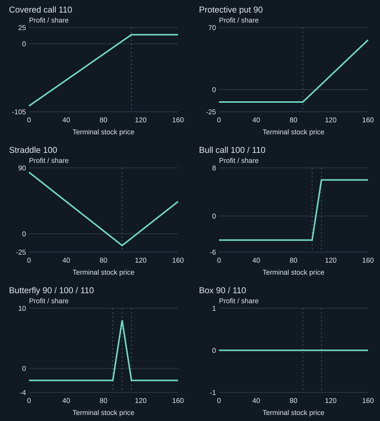

# Static option strategies as piecewise-linear cash flows

An option strategy is a signed sum of contracts. Its name may help communication, but its risk comes from the sum, its initial cost, and the dates of its obligations. A covered call has no naked call delivery shortage while retaining most of the share's downside. A protective put creates a floor while requiring an upfront premium. A box has a constant terminal payment while still costing the present value of that payment. These distinctions emerge from algebra before any market forecast enters.

The lectures move from stock-plus-option portfolios to straddles, strangles, unequal option ratios, spreads, butterflies, boxes, and calendars. We will derive them with a single consistent method. Partition the terminal stock-price domain at every strike, add signed payments in each interval, then subtract the funded initial cost. The same method handles unfamiliar portfolios and exposes mistakes hidden by a plausible-looking sketch.

## 1. Dates and entitlements come first [00:33](https://www.youtube.com/watch?v=p1T4wFkaPS8&t=33s)

Except where stated otherwise, the underlying is a nondividend share with $S_T\ge0$, all options are European and expire at the same $T$, quantities are per share, and contracts have matching settlement terms. Write $P=P(0,T)>0$ for the cash discount factor. Financing uses one frictionless borrowing/lending curve, with no taxes, default, fees, or collateral costs. Strategy profits refer to a financed initiation at time zero followed by expiry settlement, not mark-to-market gains during the holding period.

The opening source recording completes an American dividend discussion. For known nonnegative dividends with present value $I_0$ and nonnegative funding accumulation, the appropriate broad inequality is

$$S_0-I_0-K\le C_0-\Pi_0\le S_0-KP.$$

Here $C_0,\Pi_0$ are the otherwise matching American premiums. For the lower bound, buy a European call, hold $K$ current cash, and buy cash claims matching each known dividend; this superhedges share plus American put even upon early put exercise. In the equivalent seller's hedge, the cash claims meet dividends owed on a short share; upon put assignment the $K$ cash buys a share to cover that short. The call and any remaining cash claims are nonnegative. Thus $c_0+K+I_0\ge S_0+\Pi_0$, and $C_0\ge c_0$ yields the stated bound.

For the upper bound, share plus American put can cover an American call and a strike cash obligation at $T$. If the short call is exercised early, deliver the share, receive $K$, and reinvest it to cover that terminal obligation; retain the put and any previously collected dividends. If unassigned, the terminal identity supplies the strike payment. Therefore $S_0+\Pi_0\ge C_0+KP$. This argument handles early assignment directly; it does not substitute American premiums into European parity. With uncertain dividends or different funding assumptions, these hedges need reconsideration.

For the strategy calculations below we return to **European common-expiry** contracts. In particular, the constant terminal payment of a European box must not be used to erase intermediate assignment cash flows from an American combination.

## 2. A general payoff ledger

Let $a$ be the number of shares, $b$ a cash amount payable at $T$, and $w_j,v_j$ signed call and put quantities at strikes $K_j$. Positive quantities are long; negative quantities are written. The terminal portfolio payment is

$$H(s)=as+b+\sum_jw_j(s-K_j)^++\sum_jv_j(K_j-s)^+,$$

where $s=S_T$. Its initial cost is

$$D=aS_0+bP+\sum_jw_jc_j+\sum_jv_jp_j.$$

The **funded terminal profit** is

$$\boxed{G(s)=H(s)-D/P.}$$

A negative $D$ is a net initial receipt; its funded value contributes positively because it is subtracted. Avoid adding a premium receipt once in $H$ and again in $D$: exercise payoffs contain no premiums. With dividends, add their dated financed payments separately or use a properly matched prepaid-share position.

Between strikes, $G$ is affine. Its slope is

$$G'(s)=a+\sum_{K_j<s}w_j-\sum_{K_j>s}v_j,$$

away from kink points. Passing a strike adds $w_j$ from its call and $v_j$ from its put to the slope. Values at zero and all strikes, plus the final unbounded interval's slope, determine global extrema on $s\ge0$. Break-evens are roots within their relevant intervals; solving an affine extension outside its interval produces a false root. A zero lower-tail slope can yield a whole interval of break-evens, not just an isolated point.

All following numerical prices are one synthetic **zero-rate** data set, so $P=1$, with spot 100. Call premiums at strikes 90, 100, 110, and 120 are respectively 14, eight, four, and two. European parity then gives put premiums four, eight, 14, and 22. These are teaching prices rather than current market quotations. Their call prices decrease with strike, their adjacent slopes increase, and all quoted vertical-spread bounds hold. We keep $P$ in the general formulas to expose financing, then use this data set for arithmetic.

On a narrow screen, pan the atlas horizontally; keyboard users can focus the figure region and use the arrow keys. Panel ranges differ to make each strategy's limits legible.

The plotted window is finite. The accompanying formulas, rather than the edge of a plot, establish unbounded tail behavior. An expiry slope is also not automatically a before-expiry option delta: an unexpired option's market value is a different function.

## 3. Covered call and protective put [07:29](https://www.youtube.com/watch?v=p1T4wFkaPS8&t=449s)

A **covered call** owns one share and writes one call at $K$. Its payment and cost are

$$H(s)=s-(s-K)^+=\min(s,K),\qquad D=S_0-c_K.$$

Profit rises with slope one below $K$ and is constant above $K$. With strike 110 and premium four, net cost is 96, so $G(s)=\min(s,110)-96$. Break-even is 96, maximum profit 14, and loss at $s=0$ is 96. Covering the short call controls the delivery exposure from a rising share price. It does not establish a downside floor above zero or make the portfolio low risk.

The identity

$$s-(s-K)^+=K-(K-s)^+$$

shows that a covered call equals a terminal strike cash claim minus a put. European parity gives the corresponding cost identity $S_0-c_K=KP-p_K$. In the example, $110-14=96$. The stock-plus-written-call view and cash-plus-written-put view describe the same terminal payment under these assumptions, even though their practical collateral and assignment arrangements can differ.

A **protective put** buys the share and a put at $K$:

$$H(s)=s+(K-s)^+=\max(s,K),\qquad D=S_0+p_K.$$

With strike 90 and put premium four, cost is 104. The terminal floor is 90, maximum financed loss is 14, and upside profit is unbounded in this unbounded-stock model. Break-even is 104. The floor concerns the combined payment; a purchase cost above the floor still produces a loss in adverse outcomes.

Parity also gives $S_0+p_K=c_K+KP$, and the payoff equals call plus strike cash. Here the lower profit plateau is $K-(S_0+p_K)/P=-c_K/P$, which is nonpositive. A guaranteed strictly positive funded plateau would contradict the matching-price identity. The premium paid for insurance must remain in the profit calculation. [Duke's option-valuation notes, sections 4.1 and 4.3](https://people.duke.edu/~charvey/classes/ba350/optval/optval.htm), describe these stock-plus-option constructions; our explicit financing keeps their payments distinct from net terminal profit.

## 4. Straddles, strangles, strips, and straps [21:30](https://www.youtube.com/watch?v=p1T4wFkaPS8&t=1290s)

A long **straddle** buys a call and a put with the same strike $K$ and expiry. Its payment is $|s-K|$, cost $D=c_K+p_K$, and profit $|s-K|-D/P$. When $D/P\le K$, the two nonnegative break-evens are $K-D/P$ and $K+D/P$. If the proposed lower root is negative, it lies outside the stock domain and is not attainable. Maximum loss is $D/P$ at $K$. Upside profit is unbounded; downside profit is bounded because $s$ cannot fall below zero.

At strike 100, our straddle costs 16 and breaks even at 84 and 116. It loses money between those values, even if the share moved noticeably from its initial level. A large move alone does not ensure profit: its size must exceed the funded premium threshold. [OIC's long-straddle explanation, Description, Max Loss, Max Gain, and Breakeven](https://www.optionseducation.org/strategies/all-strategies/long-straddle), supports this construction and distinguishes the bounded stock downside from its unbounded upside. The price already reflects market demand for protection against moves. A prediction that an event will be dramatic does not establish that the option package is underpriced.

A conventional long **strangle** buys a put at $K_p$ and a call at $K_c>K_p$:

$$H(s)=\begin{cases}K_p-s,&s<K_p,\\0,&K_p\le s\le K_c,\\s-K_c,&s>K_c.\end{cases}$$

With total cost $D$, break-evens are $K_p-D/P$ and $K_c+D/P$, subject to the same nonnegative-domain check. Buying put 90 and call 110 costs eight; break-evens are 82 and 118. Maximum loss is eight throughout $[90,110]$. Its smaller debit than the example straddle is accompanied by a wider region of expiry loss, not a free improvement.

The source also considers reversed strikes, $K_c<K_p$, often called a **gut strangle**. Both options pay in the interval between strikes, giving constant payment $K_p-K_c$ there. For long call 90 and put 110, cost is 28 and that middle payment is 20, so minimum profit is -8. Below 90 the put payment is $110-s$; above 110 the call payment is $s-90$. Break-evens are again 82 and 118. The same profit shape here follows from parity and zero-rate financing, although the debit and cash embedded in the payoff differ. This is a useful test of the distinction between gross payments and net profits.

A **strip** buys one call and two puts at $K$; a **strap** buys two calls and one put. If their funded costs are $F_{\mathrm{strip}}=(c+2p)/P$ and $F_{\mathrm{strap}}=(2c+p)/P$, their profits are

$$G_{\rm strip}(s)=\begin{cases}2(K-s)-F_{\mathrm{strip}},&s<K,\\s-K-F_{\mathrm{strip}},&s\ge K,\end{cases}$$

$$G_{\rm strap}(s)=\begin{cases}K-s-F_{\mathrm{strap}},&s<K,\\2(s-K)-F_{\mathrm{strap}},&s\ge K.\end{cases}$$

At strike 100, both costs are 24. The strip's roots are 88 and 124; the strap's are 76 and 112. Both lose 24 at the strike. The strip has a steeper payoff toward falling prices, and the strap toward rising prices. The slope ratios describe conditional payoff sensitivity, not the holder's numerical beliefs, the probabilities of the branches, or an automatically optimal portfolio weight. Buying additional contracts increases the premium at risk as well as the tail exposure.

Short versions negate the corresponding long profit function if all legs and executable prices are exactly reversed. In practice long trades execute at asks and short trades at bids, so the two attainable costs need not be exact negatives of a midprice illustration. A short straddle has unbounded rising-price loss in this stock model and substantial bounded falling-price loss; a compact central-profit diagram should not obscure those tails.

## 5. Vertical spreads: direction with capped payments [16:16](https://www.youtube.com/watch?v=zkDVIsOARK0&t=976s)

Let $K_1<K_2$ and $W=K_2-K_1$. A **bull call spread** buys call $K_1$ and writes call $K_2$. Its terminal payment is

$$B(s)=(s-K_1)^+-(s-K_2)^+=\begin{cases}0,&s\le K_1,\\s-K_1,&K_1<s<K_2,\\W,&s\ge K_2.\end{cases}$$

The debit $D_c=c_{K_1}-c_{K_2}$ obeys $0\le D_c\le WP$ by payoff dominance. Funded profit is bounded between $-D_c/P$ and $W-D_c/P$. Its break-even in the sloping region is $K_1+D_c/P$. For calls 100 and 110, debit four gives maximum loss four, maximum profit six, and break-even 104. The strike width ten is the maximum **payment**, not the maximum profit.

Writing the upper call reduces cost from eight to four but removes payments above 110. Whether that tradeoff suits a belief or objective is a separate portfolio decision. No-arbitrage establishes a consistent price restriction, not which investor should choose the position.

A **bear put spread** buys put $K_2$ and writes put $K_1$. Its payment is $W-B(s)$, cost $D_p=p_{K_2}-p_{K_1}$, and funded profit ranges from $-D_p/P$ to $W-D_p/P$. Buying put 100 and writing put 90 costs four: break-even 96, maximum loss four, maximum profit six. A **bull put spread** reverses that bear position, while a **bear call spread** reverses the bull call position. Credit receipts do not by themselves mean profit: future exercise obligations remain.

For the same pair of strikes, parity gives

$$D_c+D_p=WP.$$

Consequently the bull call's funded profit $B-D_c/P$ equals the bull put's funded profit $(B-W)+D_p/P$. Their gross payments and initial cash flows differ by a strike cash claim; after consistent financing the terminal profit is identical. European matched contracts are essential to this statement. Early assignment, mismatched expiry, or unequal multipliers changes the actual dated ledger.

## 6. Butterflies and convexity across strikes [03:22](https://www.youtube.com/watch?v=WOeG8sV1xz8&t=202s)

For equally spaced strikes $K_1<K_2<K_3$ with $K_2=(K_1+K_3)/2$ and spacing $h$, a long call **butterfly** buys calls at the wings and writes two at the middle. Its payment is

$$L(s)=(s-K_1)^+-2(s-K_2)^++(s-K_3)^+$$

$$=\begin{cases}0,&s\le K_1,\\s-K_1,&K_1<s\le K_2,\\K_3-s,&K_2<s<K_3,\\0,&s\ge K_3.\end{cases}$$

The nonnegative tent reaches height $h$. [OIC's long-call butterfly explanation, Description and Profit/Loss](https://www.optionseducation.org/strategies/all-strategies/long-call-butterfly), specifies the equal strike spacing and matching expiry that create this tent. Therefore its debit obeys

$$0\le D_b=c_{K_1}-2c_{K_2}+c_{K_3}\le hP.$$

The lower inequality is discrete convexity of the call price as a function of strike. For wings 90 and 110 with middle 100, debit is $14-16+4=2$. Funded profit is $L(s)-2$, with maximum loss two outside the wings, maximum profit eight at 100, and roots 92 and 108.

For unequal strike spacing, quantities $1,-2,1$ no longer create a tent that returns to zero. The relative weights must change. A convexity test uses $K_2=\lambda K_1+(1-\lambda)K_3$, with $\lambda=(K_3-K_2)/(K_3-K_1)$, and the nonnegative payment $\lambda(s-K_1)^++(1-\lambda)(s-K_3)^+-(s-K_2)^+$. Its price must be nonnegative. Geometry is encoded in both strikes and quantities.

To see the mechanism, call this payment $L_\lambda(s)$. Below $K_1$ every call is worthless. Between $K_1$ and $K_2$, only the lower wing pays. Above $K_2$ the written middle call begins subtracting slope one; beyond $K_3$ the upper wing restores the total slope to zero. The weighted-strike relation also cancels the constant tail:

$$L_\lambda(s)=
\begin{cases}
0,&s\le K_1,\\
\lambda(s-K_1),&K_1<s\le K_2,\\
(1-\lambda)(K_3-s),&K_2<s<K_3,\\
0,&s\ge K_3.
\end{cases}$$

Its peak at $K_2$ is $\lambda(K_2-K_1)=(1-\lambda)(K_3-K_2)$. Hence its debit is bounded between zero and that peak times $P$. Equal spacing gives $\lambda=1/2$; doubling this normalized portfolio recovers the earlier quantities $1,-2,1$ and the earlier tent height. The two normalizations must not be mixed when computing cost or maximum profit.

For strikes 90, 100, 120, use quantities $2/3,-1,1/3$. Our quoted premiums give debit $(2/3)14-8+(1/3)2=2$, peak payment $20/3$, maximum funded profit $14/3$, and break-evens 93 and 114 at zero rates. Blindly retaining $1,-2,1$ at these unequal strikes instead gives zero initial debit but a terminal payment of $-10$ above 120. That zero cost is not an arbitrage: the misplaced weights leave a liability in the high-price tail. The full piecewise calculation detects it before a strategy name or a cropped plot can mislead.

A put butterfly at the equally spaced strikes has the same terminal tent and the same initial price under European parity: the linear strike and stock terms cancel in the second difference. Reversing all positions produces a short butterfly. The long tent favors a terminal price near its middle relative to the paid premium. That shape does not establish that its current price is maximized at the middle stock price, nor does it define an unexpired volatility sensitivity without a pricing model.

## 7. Boxes: a constant payment has a financing cost [10:57](https://www.youtube.com/watch?v=WOeG8sV1xz8&t=657s)

A long **box** combines bull call spread $K_1,K_2$ with bear put spread at the same strikes. Its payment is $B(s)+[W-B(s)]=W$ for every $s$. Hence

$$D_{\rm box}=c_{K_1}-c_{K_2}+p_{K_2}-p_{K_1}=WP.$$

For strikes 90 and 110, the call spread costs ten and the put spread costs ten. The box costs 20 and pays 20 under our zero-rate convention, so financed profit is zero. A positive terminal payment is not a positive return on a free position.

For a separate synthetic funding example with $W=20$ and $P=0.95$, fair cost is 19. If the exact executable box costs 18.50 under the frictionless model, borrow 19 repaying 20, buy the box for 18.50, and retain 0.50 initially. Its 20 terminal payment repays the loan. If it costs 19.50, short the box and buy the terminal cash claim for 19, again retaining 0.50. Each construction requires actual simultaneous executable legs and the stated funding, default, and settlement conditions.

Regrouping the box as $(\text{call}_{K_1}-\text{put}_{K_1})-(\text{call}_{K_2}-\text{put}_{K_2})$ gives terminal payments $(s-K_1)-(s-K_2)=W$. Each same-strike difference is a forward-style payoff from chapter 13. Its initial cost is generally not zero for an arbitrary strike, so calling it a synthetic forward does not erase that cost.

The constant-payment proof removes terminal stock-price exposure in the model. It does not remove counterparty default, fees, funding spreads, delivery mistakes, or intermediate American assignment. Quoting a box-implied rate without matching these terms can conflate a model identity with an attainable borrowing opportunity.

## 8. Calendar spreads require an interim valuation model [19:38](https://www.youtube.com/watch?v=WOeG8sV1xz8&t=1178s)

A **calendar** or horizontal spread uses equal strikes and different expiries; a diagonal spread changes both. Consider short call expiring at $T_1$ and long call expiring at $T_2>T_1$. At $T_1$, the short pays $(S_{T_1}-K)^+$, but the long is still an asset whose market value is $c(T_1,S_{T_1};K,T_2)$ in a model where spot and time are sufficient state variables. If the long is sold then, the closing value is

$$V_{T_1}=c(T_1,S_{T_1};K,T_2)-(S_{T_1}-K)^+.$$

With initial debit $D=c(0;K,T_2)-c(0;K,T_1)$, the financed profit at this closing date is $V_{T_1}-D/P(0,T_1)$. If the model includes stochastic volatility or rates, the long-option value also depends on those state variables. It is not determined by $S_{T_1}$ alone. Holding the long until $T_2$ instead introduces a second stock observation and an intermediate payment date.

For an explicit illustration, take zero rates, strike 100, and one remaining stock step after $T_1$ with factors $u=1.2,d=0.8$. Replication gives weight $1/2$. The long call's value at $T_1$ is

$$c_{T_1}=\tfrac12(1.2s-100)^++\tfrac12(0.8s-100)^+.$$

At $s=80,100,130$, it is respectively zero, ten, and 30. Subtracting the expiring short call's payments zero, zero, and 30 leaves closing values zero, ten, and zero. This particular model produces a tent-like calendar closing-value curve. The long call itself is *not* most expensive at the strike: its value 30 at spot 130 exceeds its value ten at spot 100. The hump concerns the difference after subtracting the short's intrinsic payment.

In this zero-rate example the difference vanishes above 125 because both future call payoffs are linear and the stock is then certain to finish above the strike. With positive funding rates, a sufficiently deep-in-the-money long call instead approaches $s-KP(T_1,T_2)$; after subtracting $s-K$, the difference approaches $K[1-P(T_1,T_2)]$, not necessarily zero. Thus even a familiar calendar sketch needs its rate assumptions.

Nor is “longer expiry means a higher European price” a universal rule. In the deterministic dividend example of chapter 14, spot is 100, strike 80, rate zero, and a cash dividend of ten falls between two expiries. The shorter European call before the ex-date pays 20; the longer after it pays ten. Longer American rights do contain shorter American rights when all other contractual entitlements match, but European exercise sets are different singleton dates. Use the relevant theorem's assumptions rather than a blanket uncertainty argument.

## 9. A reusable analytical and computational workflow

Run [the laboratory](../labs/ch15.py). It represents portfolios by signed legs, finds interval slopes and isolated break-evens, checks extrema using every strike and the final tail, and verifies parity-based identities across the complete piecewise structure. It also calculates the calendar continuation values from the explicit one-step model. Run `python labs/ch15.py --figure figures/ch15-payoff-atlas.svg` to reproduce the six-panel figure from the same functions and premiums.

The unequal-strike example uses exact rational contract quantities in the lab. This preserves an exactly zero final slope: a tiny binary floating-point remainder must not be mistaken for the intended cancellation. Conversely, a genuinely nonzero residual final slope, however small, makes one profit extreme unbounded on an unbounded stock domain. Numerical representation and economic tail assumptions must agree before declaring finite profit bounds.

To analyze a new static strategy, first list quantities, strikes, exercise styles, expiry and settlement dates. Compute its signed initial cost using the correct bid or ask for each leg. Partition the terminal domain, derive each interval's payment, include all dated funding, and solve only roots that lie in their corresponding intervals. Finally inspect zero-price exposure and the unbounded rising-price tail analytically. A finite plot or simulation grid cannot certify the absence of an unbounded loss beyond its last sample.

Expected profit and portfolio suitability require more than an expiry diagram: probabilities, the pricing of protection, capital and collateral constraints, liquidity, and the investor's objective. The strategy algebra is nevertheless foundational. It explains how nonlinear claims combine, where exact replications exist, and which apparent opportunities are merely financing or different accounting of the same payment.

## Exercises

1. Derive the general funded profit formula for a signed stock-and-option portfolio. Explain how to obtain all interval slopes and why checking a finite grid cannot establish an unbounded tail limit.
2. Using the synthetic premiums, calculate the covered call at strike 110 and protective put at strike 90. Find their break-evens and maximal losses, then prove their cash-plus-option replications.
3. Derive the straddle, conventional strangle, strip, and strap break-evens for this data set. Compare the conventional and reversed-strike strangle profits. Explain why large event risk alone does not imply that either long strategy will be profitable.
4. Derive bull call and bear put spread payments at common strikes and prove their debits sum to the discounted width. Calculate the profit bounds of the call-100/call-110 bull spread and the put-100/put-90 bear spread.
5. Derive the 90/100/110 call butterfly's full payment function, price, profit extrema, and roots. Prove its price equals the matching put butterfly. For strikes 90/100/120 with middle quantity minus one, find the wing weights and high-price tail; compare with naive quantities $1,-2,1$. Calculate the fair price and arbitrage ledger for the separate width-20 box with discount factor 0.95 and executable cost 18.50.
6. At the short expiry of the calendar example, value the remaining long call for spots 80, 100, and 130. Distinguish its value from the calendar closing value. Explain the dividend counterexample to universal European maturity monotonicity.

Fully worked solutions

1. Signed quantities give $H(s)=as+b+\sum_jw_j(s-K_j)^++\sum_jv_j(K_j-s)^+$. The initial cost is $D=aS_0+bP+\sum_jw_jc_j+\sum_jv_jp_j$ and financing it requires $D/P$ at expiry, hence $G=H-D/P$. Between strikes the slope is $a+\sum_{K_j<s}w_j-\sum_{K_j>s}v_j$. Each strike adds its signed call and put quantities to the slope. Evaluate zero and every strike for finite extrema, then inspect the final affine segment: a positive final slope makes the supremum infinite, a negative one makes the infimum negative infinite, and a zero slope leaves a constant tail. No finite endpoint substitutes for this tail argument.

2. Covered-call cost is $100-4=96$, and payment $\min(s,110)$ gives root 96, maximum profit 14, and loss 96 at zero. Its identity is $s-(s-110)^+=110-(110-s)^+$, with matching cost $110-p_{110}=110-14=96$. Protective-put cost is $100+4=104$, and payment $\max(s,90)$ gives root 104 and loss floor -14. Its identity is $s+(90-s)^+=90+(s-90)^+$, with matching cost $90+c_{90}=90+14=104$. The short-call delivery is covered while the stock downside remains; the put creates an actual payment floor at its strike.

3. The straddle costs 16 and has roots $100\pm16$, hence 84 and 116. The conventional strangle costs eight and roots are $90-8=82$ and $110+8=118$. The strip costs 24 and has roots $100-24/2=88$ and $100+24=124$. The strap costs 24 and roots are $100-24=76$ and $100+24/2=112$. Reversed-strike call 90 plus put 110 costs 28, pays 20 more than conventional put 90 plus call 110 in every state, and therefore has the same financed zero-rate profit. Event-related movement must exceed the applicable premium threshold; both movement magnitude and price paid matter.

4. The bull call payment is zero below $K_1$, $s-K_1$ between strikes, and $W$ above $K_2$. The bear put pays $W$ minus that amount. Their sum is constant $W$, so matched European costs sum to $WP$. Calls 100/110 cost $8-4=4$ and produce profit from -4 to six, with root 104. Puts 100/90 cost $8-4=4$ and produce profit from -4 to six, with root 96. The examples use different strike intervals, although both have width ten; the debit-sum identity is for spreads using the *same* two strikes.

5. The butterfly pays zero below 90, $s-90$ between 90 and 100, $110-s$ between 100 and 110, and zero beyond 110. Cost is $14-2(8)+4=2$, maximum profit eight, maximum loss two, and roots 92 and 108. Parity says $p_K=c_K-S_0+KP$; taking the second difference cancels stock and strike terms, giving put-butterfly cost $4-2(8)+14=2$. For the unequal strikes, wing quantities $\lambda=(120-100)/(120-90)=2/3$ and $1-\lambda=1/3$ cancel both tail slope and constant. The cost is two, peak payment $20/3$, and roots are 93 and 114. Naive quantities $1,-2,1$ have cost zero but tail payment $-90+2(100)-120=-10$. For the separate box, fair cost is $20(0.95)=19$. Borrow 19 to repay 20 at expiry, buy the box for 18.50, and retain 0.50 initially. The constant terminal payment 20 repays the loan under the stipulated execution and financing assumptions.

6. With remaining factors 1.2 and 0.8 and growth one, the pricing weight is one half. At spot 80 both future stock prices are below 100, giving long-call value zero. At spot 100 the payoffs are 20 and zero, giving ten. At spot 130 the payoffs are 56 and four, giving 30. Subtracting the short call's immediate payments zero, zero, and 30 yields calendar closing values zero, ten, and zero. The long call itself is increasing across these spots. A dividend between two European expiries can reduce the longer claim's stock entitlement: the deterministic spot-100, strike-80, zero-rate case gives a pre-dividend call 20 and a post-dividend call ten. The shorter European exercise date is not a right embedded inside the longer European contract.

## Sources and scope

Complete English captions for [position 34](https://www.youtube.com/watch?v=p1T4wFkaPS8), [position 35](https://www.youtube.com/watch?v=zkDVIsOARK0), and [position 36](https://www.youtube.com/watch?v=WOeG8sV1xz8) were read sequentially. The American dividend inequality, covered and protective portfolios, long and short volatility-shaped packages, ratios, vertical spreads, butterflies, boxes, synthetic forwards, and calendars are reconstructed as explicit signed and dated cash flows.

The notes distinguish payments from financed profits, use weak no-arbitrage restrictions, limit all roots to the stock domain, and derive tails analytically. The calendar's remaining option is valued rather than treated as already expired; its own price is not incorrectly described as peaking at the strike. The blanket European maturity claim is qualified with a dividend counterexample. All examples, figure data, code, and exercises are independent pedagogical constructions. Full caption reading does not claim a comprehensive audiovisual audit, current market prices, or investment recommendations.
