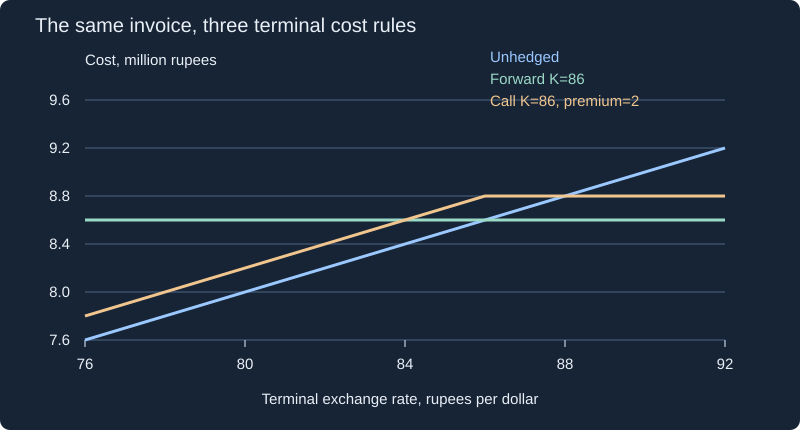
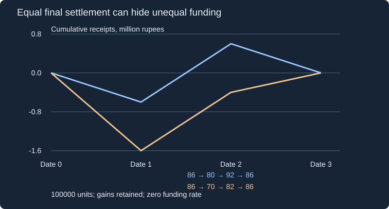

# Interactive numerical laboratory

These two finite experiments connect cash-flow replication to numbers. They run locally in the browser and use synthetic inputs. The chapter Python laboratories provide a broader set of calculations and assertions; each chapter links its downloadable code.

## A hedge changes a cost curve and a funding path

For Chapter 1's importer, a fixed 100,000-dollar invoice costs $100{,}000X_T$ rupees without a hedge. A matched forward at 86 fixes cost at 8.6 million rupees; a call at the same strike with a two-rupee-per-dollar premium caps the zero-funding-rate cost at 8.8 million. Fig. 1 plots the derived cost rules over a range of synthetic exchange rates. The call preserves the benefit of cheaper dollars but charges a premium in every state.

On narrow screens, pan the charts sideways to keep their labels readable.

<figure>

<figcaption>Fig. 1. Original computed terminal-cost curves. Quantity, dates, currency, and zero funding rate match across strategies; these are model outputs, not market quotations.</figcaption></figure>

The futures comparison in Fig. 2 uses two quotation paths with the same start and end. A 100,000-unit long position ends with zero cumulative variation-margin receipts on both paths, but one path requires a larger interim funding deficit. Gains are retained and financing is set to zero. Actual initial collateral and margin rules would add cash needs.

<figure>

<figcaption>Fig. 2. The maximum modeled cash deficit depends on the path, even when the final settlement agrees. Original calculations are reproducible with figures/make_figures.py.</figcaption></figure>

## Cash and carry: a delivery price is not a forecast

Let $S$ be the current price of one unit of a non-income-producing, storable investment asset, $r$ a constant continuously compounded funding rate, and $T$ time in years. Assume borrowing/lending at that common rate, frictionless trading, no storage cost, and feasible long/short replication. Buying the asset with borrowed money requires repayment $Se^{rT}$ at maturity. A forward delivering that same asset must therefore have delivery price $F=Se^{rT}$ under the no-arbitrage assumptions developed in Chapter 2.

The input below asks for the rate in percent and converts it to a decimal before exponentiation. Raising $r$ increases the funding required to carry the asset; it does not assert a change in the physical expected future spot price. Income, storage costs, collateral or funding asymmetry require a modified model.

<label>Spot price<input id="carry-spot" type="number" value="100" min="0.01" step="1"></label><label>Continuously compounded rate (%)<input id="carry-rate" type="number" value="4" step="0.1"></label><label>Time (years)<input id="carry-time" type="number" value="1" min="0" step="0.1"></label>

Forward delivery price: <output id="carry-forward"></output>

Try zero time, then zero rate, then a longer holding period. The zero-time limit should return the spot price. This is a model calculation, not a quote obtained from an exchange.

## One-step call replication

Let a stock cost $S$ now and become $Su$ or $Sd$ in one period, with factors $u>d>0$. Let $R>0$ be the bank-account growth factor over the same period and $K$ a European call strike. The two call payoffs are $c_u=\max(Su-K,0)$ and $c_d=\max(Sd-K,0)$.

A portfolio of $\Delta$ shares and $B$ in the bank now reproduces both payoffs when $\Delta Su+BR=c_u$ and $\Delta Sd+BR=c_d$. Subtracting gives $\Delta=(c_u-c_d)/(S(u-d))$, and the lower-state equation gives $B=(c_d-\Delta Sd)/R$. The call value is $\Delta S+B$.

The same value can be written $[pc_u+(1-p)c_d]/R$, where $p=(R-d)/(u-d)$. This weight lies strictly between zero and one when $d<R<u$, the one-period no-arbitrage interval. It is a pricing weight implied by tradable payoffs; this experiment does not estimate the physical probability of an up move.

<label>Spot<input id="tree-spot" type="number" value="100"></label><label>Up factor<input id="tree-up" type="number" value="1.2" step="0.01"></label><label>Down factor<input id="tree-down" type="number" value="0.8" step="0.01"></label><label>Strike<input id="tree-strike" type="number" value="100"></label><label>Bank growth factor<input id="tree-growth" type="number" value="1.05" step="0.01"></label>

Call value: <output id="tree-price"></output>; shares: <output id="tree-delta"></output>; risk-neutral up weight: <output id="tree-probability"></output>

For the defaults, the up payoff is 20, the down payoff is zero, the hedge has 0.5 shares, and the pricing weight is 0.625. The bank position is $-40/1.05$, so the initial portfolio costs $50-40/1.05=11.9047619$ to the shown precision. Change $R$ outside the interval and inspect the rejection. Allowing a negative pricing weight without identifying the arbitrage would hide a violated assumption.

The calculations are exact for the specified two-state frictionless model up to floating-point rounding. They do not establish completeness in a richer market, continuous hedge feasibility, or a correct volatility model for observed prices. Chapters 18–21 develop those distinctions.
